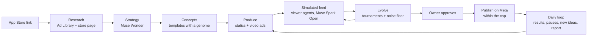

# whynot

**An AI ad agency for small businesses on Meta.** Paste your App Store link. whynot's agents research your market and your customers, write the strategy, make static and video ads, **test every ad in a simulated feed next to your competitors' real ads before you spend anything**, then publish, steer and report within the cap you set. You only check and approve.

Built during the [Meta Global AI Developer Hackathon](https://cerebralvalley.ai/e/meta-ai-developer-hackathon) (Oct 26 – Nov 4, 2026), Indie Developer track, theme *Build for Your World*.

---

## The problem

- **Small businesses can't run Meta ads well.** An agency costs thousands a month. Doing it yourself means a new concept every 2–3 weeks (creative wears out fast), guessing what will work, and paying Meta to find out.
- **Meta automates delivery, not creation.** Targeting, bidding and budgets are automated; the creative is the last lever. Advantage+ adjusts your visuals; it doesn't invent a new concept.
- **Testing costs real money.** The learning phase spends your budget. A traditional pre-test (Kantar, System1) costs $4,500–$11,000 per ad.

## What whynot does

The engine is a loop: **templates generate, the simulator judges, the agents evolve.**



1. **Research.** The scout pulls competitors' running ads from the Meta Ad Library (copy, creative, how long they ran, who Meta shows them to) and reads the app's store page and reviews.
2. **Strategy.** Muse Wonder reads the whole corpus and writes customer profiles, the angles that work and the angles nobody uses.
3. **Concepts.** A creative director writes distinct ad concepts, each backed by evidence, each with a *genome* (hook, proof, persona, layout) that can mutate.
4. **Produce.** Code composes the statics; the real app screen is cut out of the store screenshots by SAM 3.1 and never generated (pixel-diff guard). Video ads are storyboarded skits on a trending format: Muse Image photos with one consistent cast, the real app animated in a phone, ElevenLabs voices, word-by-word captions, rendered with Remotion, loudness-normalised and checked by transcription.
5. **Test before spending.** Every ad is placed in a simulated feed between competitors' real ads. Viewer agents (personas from the strategy) say whether they noticed it, understood it, believed it, **why not**, and which ad they prefer.
6. **Evolve.** Agents mutate the genome; each generation meets its parents, the generation-0 champion and a placebo in a head-to-head tournament (Bradley-Terry). A gain counts only above the measured noise floor.
7. **Run.** After the owner's approval, ads are published on Meta (everything created PAUSED, activated only on approval), one cap for the account, Meta keeps bidding and delivery. A daily loop reads results, pauses losers and tired ads, ships new ideas and writes a report. A kill switch pauses everything at once.

**Honest by construction.** Every simulated number is labelled *simulated*; every reliability claim comes from `validate/`. Every model call goes through one client that logs its real cost.

## Built with Meta models

| Model | What it does here |
|---|---|
| **Muse Wonder** | Strategist: reads the market and the app in one call, writes profiles and angles |
| **Muse Spark** | Agents: scout, creative director, evolver, video storyboard writer, viewer critic, screen picker |
| **Muse Spark Open** (open weights, on Baseten) | The viewer agents of the simulated feed: thousands of calls, bias-tested |
| **Muse Image** | Photos for the video ads, one cast across a whole storyboard; never a phone screen, logo or text |
| **SAM 3.1** | Cuts the real interface and the mascot out of store screenshots; finds call tiles to animate |
| **Muse Voice Transcribe** | Listens to the final mix of every video and flags it if the audio drifts from the captions |

Plus the **Meta Ad Library API** (research and the competitors in the simulated feed) and the **Marketing API** (publishing, insights, kill switch).

## Measured so far

All numbers come from real runs in this repo's logs. Status per target: [`docs/TARGETS.md`](docs/TARGETS.md#6-where-we-are-at-submission).

| What | Result |
|---|---|
| Full agency run on a real app (VietBuddy): 127 competitor ads, 4 profiles, 24 variants simulated + 2 evolution rounds, 12 ads in a capped campaign plan | **6.5 min, $1.78** |
| Product pixels never invented (pixel-diff guard) | **0 px changed on 80/80 static ads** (VietBuddy 56, WhatsApp 24) |
| Evolution judged by tournaments (VietBuddy, 2 audiences) | gen 2 beats gen 0 beyond the noise floor in **2/2** (+3.89 vs floor 2.31; +3.46 vs 1.55), *simulated*; fake world with a known better mutation: found in 92 % of seeds, 7 % false alarms |
| Bias suite on the viewer agents (288 views, $1.06) | **flagged**: unknown brand name −0.47, emoji −0.30; not biased by copy length, label leak or position |
| Does the simulator predict which competitor ads run long? (R3, 186 ads, 44 advertisers) | **No, not yet**: within-advertiser AUC 0.52 [0.44, 0.60]; a plain "shorter copy" heuristic gets 0.62. Reported as a limit |
| Publishing on a real ad account | campaign, ad sets, static and video ads created and read back with **no issue**, all PAUSED, $0 spent |
| Video ads | 15–22 s, 9:16, ~$0.10–0.30 of model cost each, plus ElevenLabs voices |
| Total model spend for the whole hackathon (this machine) | **$5.5** (`whynot costs`) |

Not done yet, and said so: the partner backtest (R1) and the live pilot (R4/R5) wait for the design partner's data and approval; human agreement (R2/R6) and the distilled student viewer were cut for time.

## Run it

```bash
uv sync                                  # Python 3.12+
cp .env.example .env                     # then fill in the keys (see docs/META_APIS.md)
./scripts/check.sh                       # lint, types, ~900 tests, web tests: what CI runs, no network

# the agency on any app, nothing published
uv run whynot create "https://apps.apple.com/us/app/<app>/id<id>" --countries US --daily-cap 20 --budget-usd 3
uv run whynot video outputs/runs/<run> --tone humor     # video ads (humor | factual | emotional)

# the platform
cd web && npm install && npm run dev                     # http://localhost:3100, reads outputs/runs/

# on Meta (sandbox or an owner-approved account; everything PAUSED until approved)
uv run whynot connect --token-stdin
uv run whynot agency "<App Store link>" --countries US --daily-cap 20 --connection <file>
uv run whynot stop outputs/runs/<run> --by "<name>" --live   # kill switch
uv run whynot costs                                          # real model spend
```

Every live action needs the owner's written consent, a hard spend cap and an explicit approval. Dry-run is the default.

## Repository

```
src/whynot/ingest     App Store, Ad Library, creatives
src/whynot/agents     scout, strategist, director, evolver, video storyboard, critic
src/whynot/create     composer, guards, Remotion video props
src/whynot/sim        personas, feeds, viewer agents, tournaments
src/whynot/validate   backtest, retest, bias suite, frozen predictions, stats
src/whynot/agency     create pipeline, daily loop, orchestrator, report
src/whynot/run        Meta publishing, insights, kill switch, scheduling
video/                Remotion compositions (TypeScript)
web/                  the platform (Next.js)
```

## Docs

- [Targets and where we are](docs/TARGETS.md) · [Product](docs/PRODUCT.md) · [Architecture](docs/ARCHITECTURE.md)
- [Meta automation](docs/META_AUTOMATION.md) · [Meta APIs notes](docs/META_APIS.md) · [Pilot checklist](docs/PILOT.md)
- [Demo script](docs/DEMO.md) · [Decision log](docs/DECISIONS.md) · [Roadmap](docs/ROADMAP.md) · [Status](docs/STATUS.md)
- [Research](docs/RESEARCH.md) · [Competitive landscape](docs/COMPETITION.md) · [Prior art](docs/PRIOR_ART.md)

## Built during the hackathon

Everything in this repository was written during the hackathon, from Oct 26, 2026; the commit history is the record. Open-source libraries only (licences in `docs/DECISIONS.md`). Related prior work we learned from (ideas only, no code): [VoodRadar](https://github.com/edouardfoussier/voodoo-anthropic-hack-winner). See [Prior art](docs/PRIOR_ART.md).

## Team

- Matteo Atkinson ([@Chocolatine75](https://github.com/Chocolatine75))
- Tom Angles ([@Tooom123](https://github.com/Tooom123))

## License

MIT
