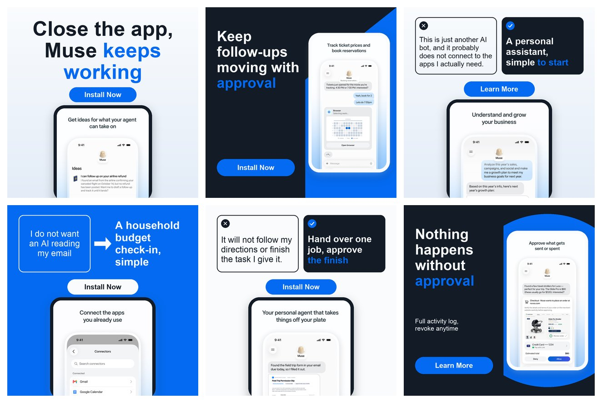
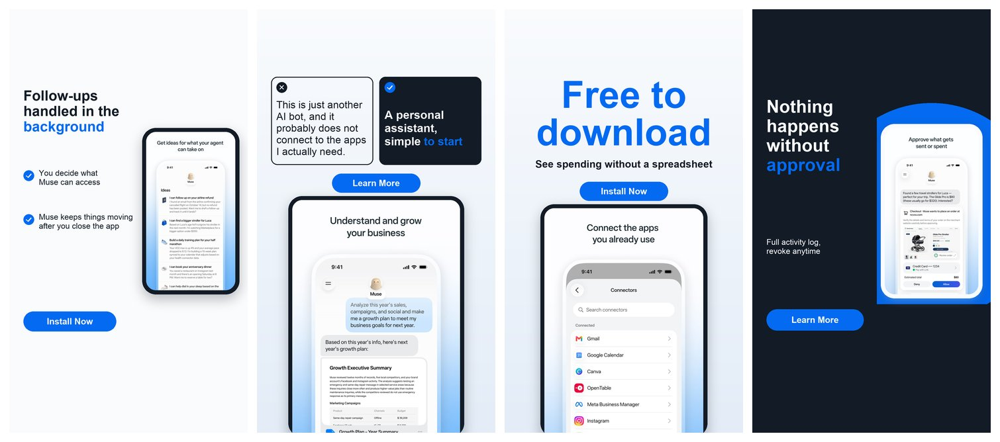
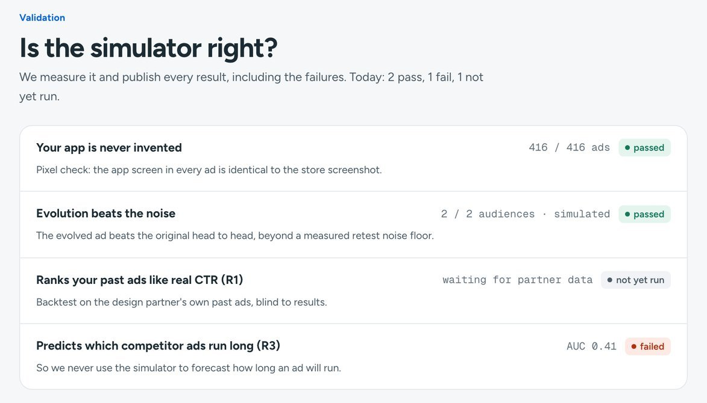

<div align="center">

# whynot

### **An AI ad agency for small businesses on Meta.**

[](https://cerebralvalley.ai/e/meta-ai-developer-hackathon)

[](https://www.python.org/)
[](https://nextjs.org/)
[](https://www.remotion.dev/)
[](https://ai.meta.com/)
[](https://www.baseten.co/)
[](https://ai.meta.com/sam/)
[](scripts/check.sh)

**Paste your App Store link → agents research your market, write the strategy,**
**make static and video ads, test every ad in a simulated feed next to your competitors' real ads,**
**then publish, steer and report on Meta, within the cap you set. You only check and approve.**



*↑ Six of the 24 static ads whynot made for **Muse from Meta** (a concept campaign, not an official Meta ad). Every one is a different concept written from the store page and reviews, laid out by code, and every phone screen is the **real app screenshot, pixel for pixel**: the pixel guard checks it on every ad. Model cost of the whole run: **$0.98**.*

</div>

---

## TL;DR: what whynot does

> **As the owner of a small app making $20k a month, I want ads on Instagram and Facebook that actually work, without paying an agency thousands a month, without guessing, and without paying Meta to find out that my ad was bad.**

Small businesses can't run Meta ads well. An agency costs thousands a month. Doing it yourself means a new concept every 2–3 weeks (ads wear out), guessing what will work, and paying the learning phase to find out. Meta automates targeting, bidding and budgets; **the creative is the last lever**, and nobody makes it for them. A traditional pre-test (Kantar, System1) costs $4,500–$11,000 per ad.

whynot is the agency. One command (or one search bar) takes an App Store link and runs it end to end:

1. **Researches** the market: competitors' running ads from the **Meta Ad Library** (copy, creative, how long they ran, who Meta shows them to) plus the app's store page and reviews.
2. **Writes the strategy** with **Muse Wonder**: customer profiles, what stops each one from installing, the angles that work, the angles nobody uses.
3. **Writes concepts**, not variations: a creative director agent (**Muse Spark**) writes distinct ad concepts, each backed by evidence, each with a **genome** (hook, proof, layout, style...) that can mutate.
4. **Produces the ads deterministically.** Statics are composed by code (13 layouts × 5 styles × 4 decors, in 1:1, 4:5 and 9:16); the real app screen is cut out of the store screenshots by **SAM 3.1** and never generated. Video ads are storyboarded skits on a trending format, rendered with Remotion.
5. **Tests every ad before a cent is spent.** Each ad is placed in a simulated feed **between competitors' real ads**. Viewer agents (the customer profiles, on **Muse Spark Open**) say whether they stopped, understood, believed it, **why not**, and which ad they prefer.
6. **Evolves** the winners: one change per round, kept only if it wins head-to-head **beyond a measured noise floor**.
7. **Runs the campaign on Meta**: everything created PAUSED, launched only on the owner's approval, one spend cap, a daily loop that reads results, pauses losers and tired ads, ships new ideas and writes a report. A kill switch pauses everything at once.

A design choice we leaned on hard: **the simulator is a measured proxy, not an oracle.** Every simulated number is labelled *simulated*; every claim about how reliable it is comes from `validate/`, **including the experiment that failed** (see below).

---

## Built on Meta models: six of them, each with its own job

| Model | What it does in whynot |
|---|---|
| **Muse Wonder** | The strategist: reads the whole market and the app in one call, writes customer profiles and angles |
| **Muse Spark** | The agents: scout, creative director, evolver, video storyboard writer, tone critic, screen picker |
| **Muse Spark Open** (open weights, on Baseten) | The viewer agents of the simulated feed: thousands of calls, bias-tested |
| **Muse Image** | Photos for the video ads, one cast kept across a whole storyboard; never a phone screen, logo or text |
| **SAM 3.1** | Cuts the real interface and the mascot out of store screenshots; finds the tiles to animate |
| **Muse Voice Transcribe** | Listens to the final mix of every video and flags it when the audio drifts from the captions |

Plus the **Meta Ad Library API** (research, and the competitors inside the simulated feed) and the **Marketing API** (publishing, insights, kill switch).

---

## The method: how whynot makes ads that deserve the money

### 1 · Research: the market, as Meta sees it

The scout pulls every running ad of the category from the Ad Library (`ads_archive`, v26.0) and keeps what matters to tell a winner from a test:

| Signal | Why it matters | Field |
|---|---|---|
| **Longevity** | An ad that runs for months is paying for itself; one stopped after a week was a test that lost. | `ad_delivery_start_time`, `ad_delivery_stop_time` |
| **Reach and audience** | Who Meta actually delivers it to, by age, gender and country (EU/UK ads). | `eu_total_reach`, `age_country_gender_reach_breakdown` |
| **Copy and creative** | The hook, the promise, the format. Creatives are captured from the snapshot page and shown to the viewers. | `ad_creative_bodies`, `ad_creative_link_titles`, `ad_snapshot_url` |

The Ad Library embeds the access token in every snapshot and paging URL; whynot **strips it before anything is stored, logged or displayed**.

### 2 · Strategy: who to talk to, and why they don't install yet

**Muse Wonder** reads the competitor corpus, the store page and up to 150 reviews in one call and writes a typed strategy: customer profiles (age, countries, what they want), **objections** in the customers' own words, angles that already work in the market and angles nobody uses. Every claim an ad may make later must trace back to this file: verified store facts, verbatim ≥ 4★ reviews, real numbers. Nothing else.

### 3 · Concepts with a genome

The creative director (**Muse Spark**) writes one concept per angle and customer profile. A concept is a template with fixed parts (brand, real screen, language, verified facts) and **genes** that can mutate:

```yaml
id: always_working_in_background_en_v1
concept: Muse keeps monitoring and following up after the app is closed, then alerts only when needed.
persona: overloaded_professionals_and_freelancers
objection: too_slow_to_be_useful
evidence: { angle: always_working_in_background, claims: [works_after_app_closed, price_drop_alerts] }
genes:
  hook:   [question, bold_claim]
  proof:  [rating, none]
  layout: [split, rising, full_screen, benefits, note, two_screens, ...]   # only the ones its facts allow
  style:  [light, dark, brand, gradient, shape]
  decor:  [none, panel, diagonal, circle]
  format: [portrait, square]                                       # + a 9:16 story version of each
```

Headlines follow rules taken from what runs long on Meta: **≤ 7 words, an action, no filler, no AI-copy templates.** On a test set, 30/30 weak headlines are refused and 28/30 long-running competitor headlines pass. A 4-word phrase used in an earlier ad is refused, and promise words (*instant, perfect, guaranteed...*) are allowed only when the store page says them.

### 4 · Production: code composes, models never touch the product

Statics are **composition, not generation**: 13 layouts (`split`, `review_card`, `before_after`, `big_number`, `comparison`, `offer`, `note`, `two_screens`...), each allowed only when the concept has the fact it needs (a `review_card` needs a real review, an `offer` a verified store offer). Each variant of a concept gets **its own look**, because Meta's delivery groups ads that look alike and lets them compete as one.

<div align="center">


*↑ Every feed ad also ships as a 9:16 Story/Reels version, with the text kept out of the zones Meta covers.*
</div>

Every ad passes four guards before it can be published:

| Guard | What it checks |
|---|---|
| `product_pixels_unchanged` | The app screen in the ad is **identical** to the store screenshot. **620/620** static ads on this machine, 0 pixels changed. |
| `text_legible` | Contrast of every text block against its background (stricter for small text) |
| `brand_palette` | Every colour drawn comes from the brand palette, taken from the app's icon |
| `policy_safe` | Rule-based check of every text against Meta ad-policy rules |

**Video ads** are storyboarded skits on formats that trend on Reels: a hook word by word, no picture held over 1 s, a call to action mid-video, **Muse Image** photos with one consistent cast (later shots are edits of the first, with new poses), the real app animated inside a phone, voices, word-by-word captions, loudness at -14 LUFS, and a final check by **Muse Voice Transcribe**. They never invent a person who "used" the app: no fake testimonials, no @usernames, no one else's footage or music. Static ads also get **motion versions** for Reels (`whynot motion`, $0).

### 5 · The simulated feed: tested before a cent is spent

Each ad is dropped into a feed **between the competitors' real ads**, the ones most relevant to its language and topic. Viewer agents play the customer profiles from the strategy and scroll it like a person:

```
You simulate one specific person scrolling their Instagram or Facebook feed.
You are: a woman aged 25-34 living in US; <traits from the strategy's customer profile>
Be realistic: people scroll past most ads, are wary of advertising, and rarely want to buy.
```

Per ad they answer, in strict JSON: **stopped? understood? believed? why not?** (in their own words), purchase intent 1–5, and which ad of the feed they prefer. Ads get neutral labels (A1, A2...) in a different random order for each viewer. **Placebos** (a competitor's ad shown under our name) give a reference point: an ad that loses to a placebo is not better than the market, whatever its score says.

The viewers see the pictures, ours and the competitors' (**$0.0138 per feed**). Answers are cached by the exact request, so a view is never paid twice. Simulated reactions only: whynot never claims to predict scroll behaviour or retention curves.

### 6 · Evolution: tournaments and a noise floor

When ads beat the market easily, every score hits the ceiling and can no longer tell variants apart. So evolution is judged **head-to-head**:

```
generation n:  parents  +  children (one gene changed by the evolver)  +  gen-0 champion  +  placebo
                    │
                    ▼
round-robin fair feeds (each pair meets in several feeds, with real competitor ads around)
                    │
                    ▼
Bradley-Terry strengths, bootstrap 95 % intervals over viewers
                    │
                    ▼
same feeds replayed with a fresh draw  →  the gap between the two rankings = the NOISE FLOOR
                    │
                    ▼
a child is a winner only if it beats its parent by more than the floor, and the retest agrees
```

**Muse Spark** writes each mutation with a reason ("answers *I've been burned by apps before* by quoting a real App Store review"). The whole loop stays within a dollar budget and keeps the best so far.

### 7 · Running on Meta, within the owner's caps

- `whynot connect`: Facebook login → a 60-day token, renewed on its own; finds the ad account and the Page.
- **Objective chosen for you**: app installs if the app is registered with Meta, otherwise traffic to its website (so Meta never blocks the ads).
- Everything is created **PAUSED** and read back from Meta. Nothing goes live without the owner's written consent, a hard spend cap and an explicit approval.
- Autonomy levels: `dry_run` (default) → `propose` (approve each action) → `autopilot` (acts within caps, every action reported).
- A **daily loop** (`whynot schedule`) reads results, pauses losers and tired ads, makes new ads from new ideas and writes the report. **Kill switch**: one command or one button pauses every campaign, ad set and ad whynot created.
- whynot manages creative and its rotation; **it never overrides Meta's bidding or delivery.**

---

## Is the simulator right? We measure it, including the failures

<div align="center">

</div>

| What | Result |
|---|---|
| Product pixels never invented (pixel guard, logged at creation) | **620/620** static ads, 0 pixels changed |
| Evolution beats the noise (VietBuddy, 2 audiences) | gen 2 beats gen 0 beyond the floor in **2/2** (+3.89 vs floor 2.31; +3.46 vs 1.55), *simulated* |
| Does the tournament find a real improvement? (fake world with a known better mutation, 60 seeds) | found in **92 %** of seeds, **7 %** false alarms |
| Bias suite on the viewer agents (288 views, $1.06) | **flagged**: unknown brand name −0.47, emoji −0.30; not biased by copy length, label leak or position |
| Does the simulator predict which competitor ads run long? (R3, 186 ads, 44 advertisers) | **No, not yet**: within-advertiser AUC **0.52** [0.44, 0.60]; a plain "shorter copy" rule gets 0.62. Shown on the site as a limit, never hidden |
| Publishing on a real ad account | **3** campaigns created and read back with no issue (campaign, ad sets, static and video ads), all PAUSED, **€0** spent |
| Full agency run on a real app: 127 competitor ads, 4 profiles, 24 variants simulated, 2 evolution rounds, a 12-ad capped plan | **6.5 min, $1.78** |
| Total model spend for the whole hackathon (this machine, 10,243 billed calls) | **$69.75** |

**Every number above is recomputed from the logs by one command, at $0:**

```bash
uv run whynot reproduce        # 9 reproduced, 0 differ, 0 missing · $0 (no model call)
```

Not done yet, and said so: the partner backtest (R1) and the live pilot wait for the design partner's data and approval; human agreement studies and a distilled student viewer were cut for time. The evolution result is the simulator's consistent preference, not proof about people.

---

## The platform

The Next.js site is the owner's side: a search bar to start the agency, a page per campaign (best ads per customer, the simulated feed, how the ads got better, every ad, the market, the strategy, the launch), a dashboard of every ad of every app, the validation page, and the Meta account page with Approve, *Run today*, *Every morning* and the kill switch.

---

## Architecture

```
                 ┌─────────────────────────────────────────────┐
                 │  web/  (Next.js)                            │
                 │  search bar · campaign page · dashboard     │
                 │  validation · Meta account (approve / stop) │
                 └──────────────────────┬──────────────────────┘
                                        │ CLI + JSON (whynot ... --json)
                 ┌──────────────────────▼──────────────────────┐
                 │  whynot  (Python engine)                    │
                 │  app → market → strategy → creative →       │
                 │  produce → simulate → evolve → plan →       │
                 │  report → publish → daily loop              │
                 └──┬────────┬────────┬────────┬────────┬──────┘
                    │        │        │        │        │
                    ▼        ▼        ▼        ▼        ▼
            ┌──────────┐ ┌────────┐ ┌───────┐ ┌──────┐ ┌───────────┐
            │Ad Library│ │ Muse   │ │ Muse  │ │ SAM  │ │ Marketing │
            │ + App    │ │ Wonder │ │ Spark │ │ 3.1  │ │ API       │
            │  Store   │ │ Spark  │ │ Open  │ │      │ │ (PAUSED)  │
            └──────────┘ │ Image  │ │viewers│ └──────┘ └───────────┘
                         │ Voice  │ └───────┘
                         └────────┘
                                        │
                 ┌──────────────────────▼──────────────────────┐
                 │  outputs/runs/<run>/  one folder per run    │
                 │  market_ads.jsonl  strategy.json  templates/│
                 │  ads/  variants.json  simulation.json       │
                 │  evolution.json  plan.json  videos/         │
                 │  events.jsonl  costs.jsonl  report.md       │
                 └─────────────────────────────────────────────┘
```

Each stage reads and writes plain files you can open, so any stage can be rerun alone (`--resume --redo-from simulate`). **Every model call goes through one client** that logs tokens, images and dollars, so the cost counter is real (`whynot costs`). Every agent action is logged with its inputs, outputs, guard results and cost. Model answers can be recorded and replayed (cassettes), which is how the test suite runs the whole pipeline with no network.

---

## Repository

```
src/whynot/
├── ingest/       App Store, Meta Ad Library, competitor creatives (token stripped)
├── agents/       scout, strategist, director, evolver, trend & video briefs, critic
├── assets/       brand palette, SAM 3.1 cut-outs, screen picker
├── create/       composer (13 layouts), headline rules, guards, Remotion props, motion
├── audio/        voices, word-by-word captions
├── sim/          personas, feeds, viewer agents, tournaments, relevance
├── validate/     backtest, retest, bias suite, frozen predictions, stats
├── agency/       create pipeline, daily loop, orchestrator, report, selection
├── run/          Meta publishing, insights, autopilot policy, kill switch, scheduling
├── models.py     the one model client (cost of every call)
└── cli.py        whynot create | video | motion | agency | daily | publish | stop | reproduce | costs ...
video/            Remotion compositions (TypeScript)
web/              the platform (Next.js)
validate/results/ every validation result, as JSON
docs/             product, architecture, targets, decisions, Meta APIs, demo script
```

---

## Run it

### Prerequisites

- Python 3.12 and [`uv`](https://github.com/astral-sh/uv); Node 20+ for the site and video rendering
- Keys in `.env` (see [`.env.example`](.env.example)): `MODEL_API_KEY` (Meta Model API), `BASETEN_API_KEY` (Muse Spark Open), `FB_TOKEN` (Ad Library), `ELEVENLABS_API_KEY` (voices); Meta app id/secret for publishing

### The agency, nothing published

```bash
uv sync
cp .env.example .env                     # then fill in the keys
./scripts/check.sh                       # lint, types, 960+ tests, web tests: what CI runs, no network

uv run whynot create "https://apps.apple.com/us/app/<app>/id<id>" --countries US --daily-cap 20 --budget-usd 3
uv run whynot video  outputs/runs/<run> --tone humor     # video ads: humor | factual | emotional
uv run whynot motion outputs/runs/<run>                   # motion versions of the statics, $0
```

### The platform

```bash
cd web && npm install && npm run dev     # http://localhost:3100, reads outputs/runs/
```

### On Meta (sandbox or an owner-approved account; everything PAUSED until approved)

```bash
uv run whynot connect --token-stdin
uv run whynot agency "<App Store link>" --countries US --daily-cap 20 --connection <file>
uv run whynot schedule outputs/runs/<run> --at 08:00          # the daily loop, by itself
uv run whynot stop outputs/runs/<run> --by "<name>" --live    # kill switch
uv run whynot costs                                           # real model spend
```

Every command and its JSON output: [`docs/META_AUTOMATION.md`](docs/META_AUTOMATION.md).

---

## Tech stack

| Layer | Tool |
|---|---|
| Engine | Python 3.12 · uv · dataclasses · Pillow · Playwright · pytest |
| Meta models | Muse Wonder · Muse Spark · Muse Spark Open (Baseten) · Muse Image · SAM 3.1 · Muse Voice Transcribe |
| Meta APIs | Ad Library (`ads_archive` v26.0) · Marketing API · Facebook Login (60-day tokens) |
| Video | Remotion · ElevenLabs voices (Meta has no text-to-speech model) · ffmpeg |
| Statistics | Bradley-Terry · bootstrap CIs · test-retest noise floor · within-advertiser AUC · hashed frozen predictions |
| Platform | Next.js · TypeScript |
| Reliability | One cost-logging model client · cassettes (record/replay) · viewer cache · event log · CI on every push |

---

## One last ad

<div align="center">


*A 22-second video ad whynot wrote and rendered for **Muse from Meta** (concept, not an official Meta ad): a "POV" skit on a format that trends on Reels, one cast across the photos (Muse Image), the **real app screens** animated in a phone, a verbatim 5★ App Store review, captions word by word, checked by ear by Muse Voice Transcribe. Sound is in the MP4; this preview is a silent GIF.*

</div>

---

## Built during the hackathon

Everything in this repository was written during the [Meta Global AI Developer Hackathon](https://cerebralvalley.ai/e/meta-ai-developer-hackathon) (Oct 26 – Nov 4, 2026, Indie Developer track, theme *Build for Your World*); the commit history is the record. Open-source libraries only (licences in [`docs/DECISIONS.md`](docs/DECISIONS.md)). The ads shown here are concept ads made by whynot from the public App Store page of Muse from Meta; they are not official Meta ads. Related prior work we learned from (ideas only, no code): [VoodRadar](https://github.com/edouardfoussier/voodoo-anthropic-hack-winner); see [Prior art](docs/PRIOR_ART.md).

**Docs:** [Targets and where we are](docs/TARGETS.md) · [Product](docs/PRODUCT.md) · [Architecture](docs/ARCHITECTURE.md) · [Meta automation](docs/META_AUTOMATION.md) · [Meta APIs](docs/META_APIS.md) · [Pilot checklist](docs/PILOT.md) · [Demo script](docs/DEMO.md) · [Decisions](docs/DECISIONS.md) · [Research](docs/RESEARCH.md) · [Competition](docs/COMPETITION.md)

## Team

Built by **Matteo Atkinson** ([@Chocolatine75](https://github.com/Chocolatine75)) and **Tom Angles** ([@Tooom123](https://github.com/Tooom123)).

## License

MIT
