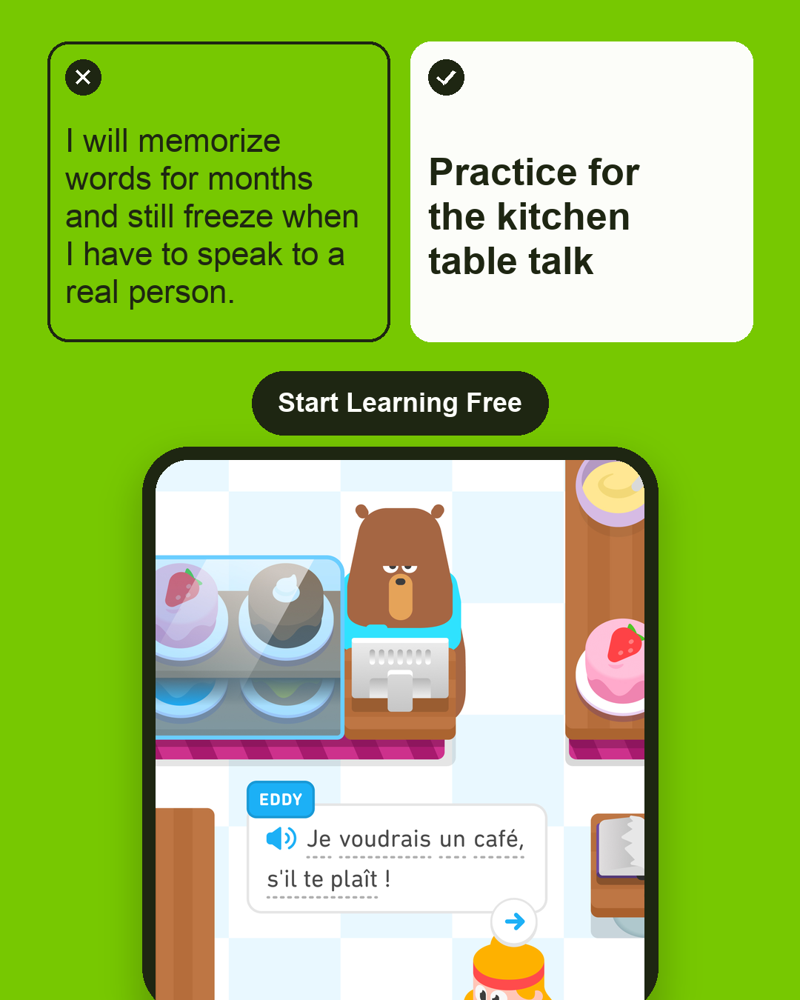
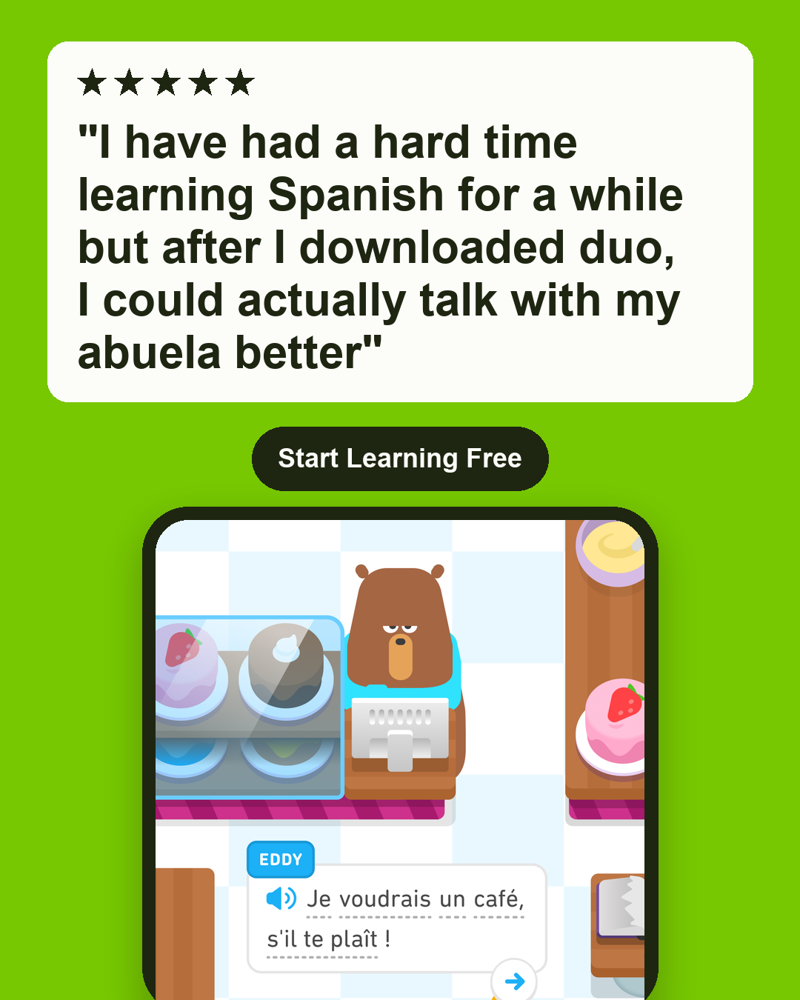
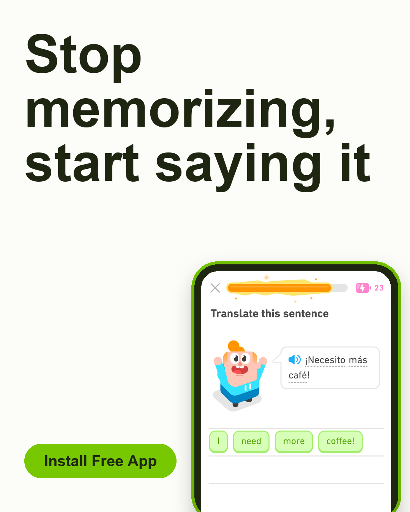
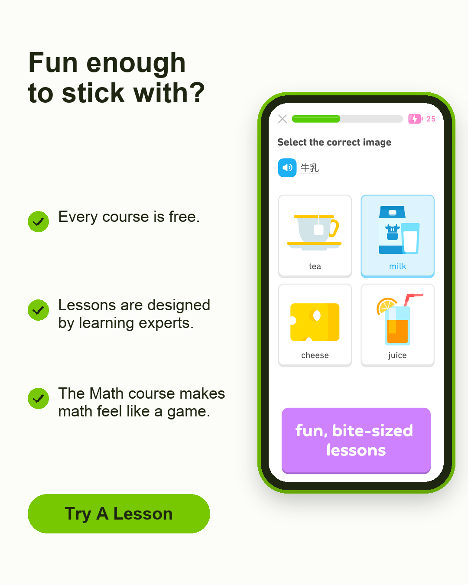
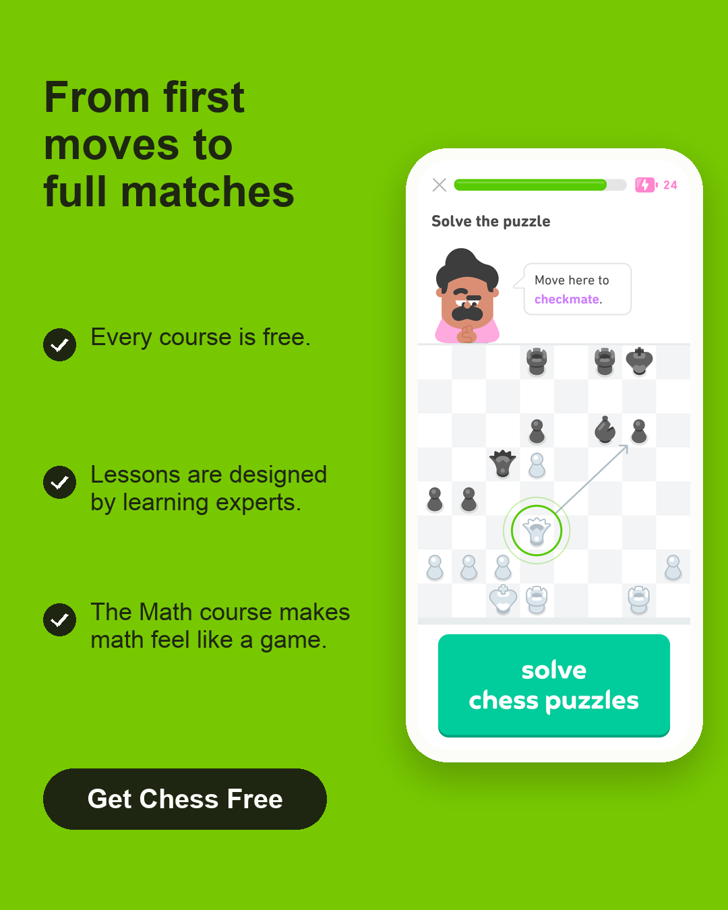
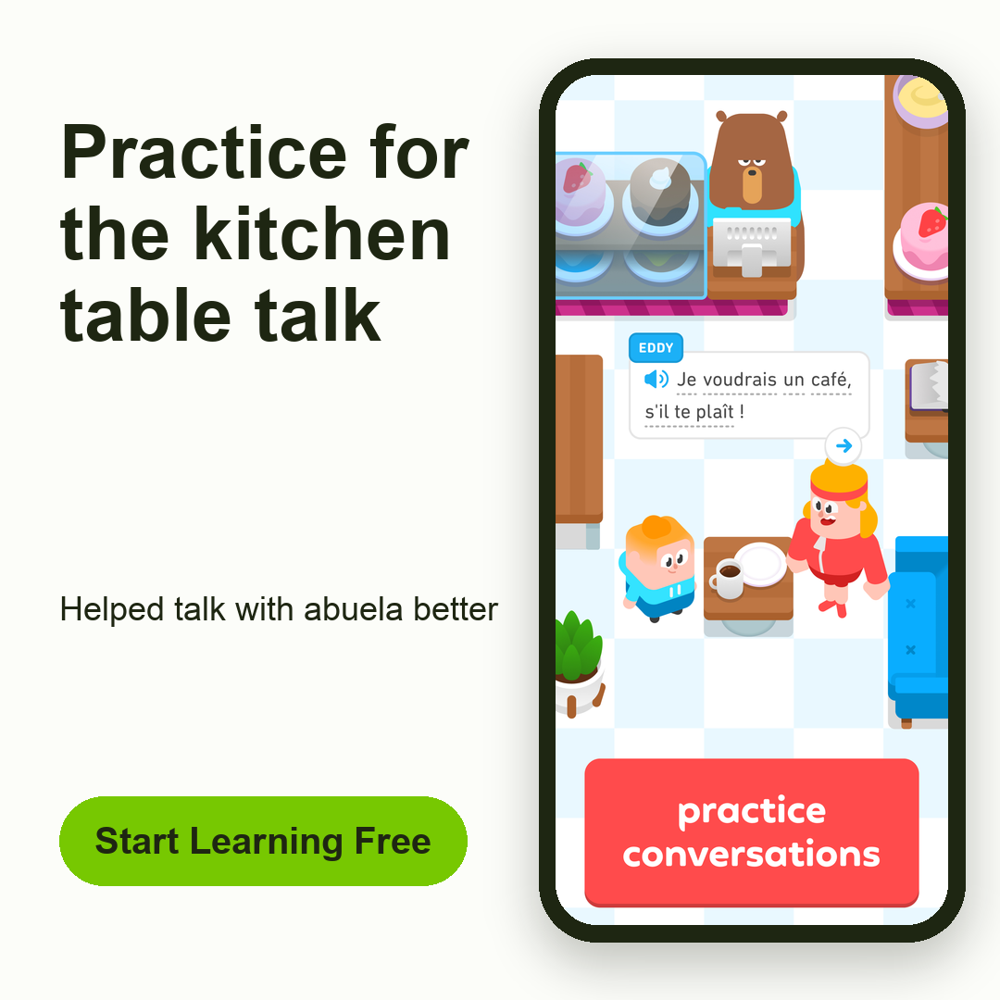
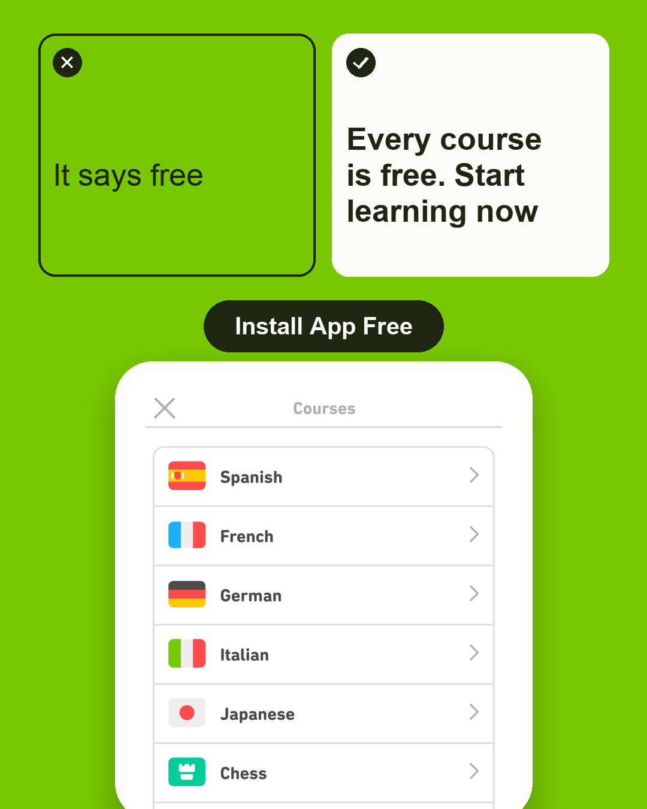
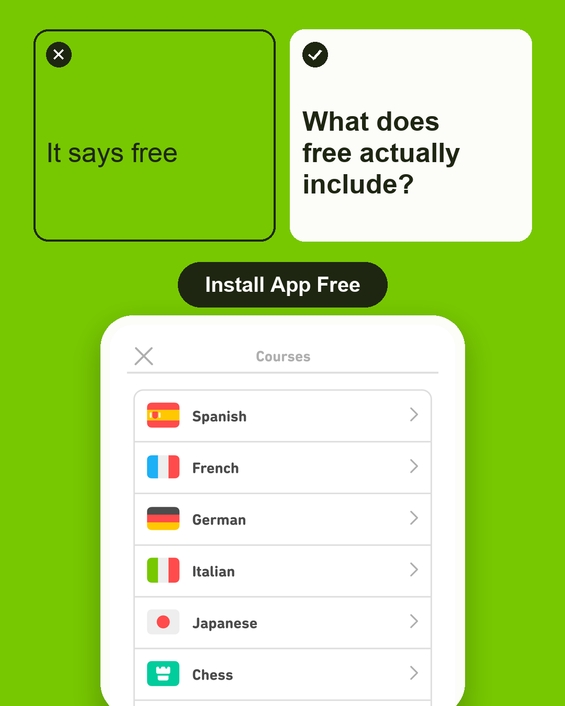

# Campaign proposal: Duolingo: Learn Languages

> **Status: not launched.** Everything below is a proposal, created PAUSED. Autonomy level: `autopilot`. Nothing is spent until you approve and set a live budget cap.

## Summary

- Researched **118** advertisers, kept **23** real competitors, read **66** of their ads (Ad Library, GB).
- Read **150** App Store reviews.
- **4** customer profiles, **6** objections, **9** ad angles, all backed by quotes.
- Produced **36** ad variants; **36** passed every check (real app pixels, legibility, brand colours, Meta policy rules).
- Each variant was tested head-to-head in simulated feeds next to real competitor ads, against a placebo (a real competitor ad shown under our name) (SIMULATED).
- Proposed campaign: **2** ad set(s), **6** ads, **€10.0/day** (your cap: €10.0/day).
- Model spend for this campaign folder (all runs and redos): **$4.05**.

## How reliable is the simulation?

Each audience's feeds include placebos: real competitor ads shown under our name and layout. If placebos win as often as our ads, the setup, not the ad, is doing the work.

| Audience | Placebo preference | Placebo intent | Placebo views | Verdict |
|---|---|---|---|---|
| heritage_family_reconnector (en) | 0.00× | 1.3/5 | 18 | usable for ranking |
| busy_travel_school_career_beginner (en) | 0.00× | 1.3/5 | 20 | usable for ranking |
| parent_learning_supporter (en) | 0.22× | 1.2/5 | 18 | usable for ranking |
| chess_math_music_curious (en) | 0.00× | 1.0/5 | 18 | usable for ranking |

## How the ads evolved (SIMULATED)

Each round, the best ads were changed in ONE element to answer what simulated viewers objected to. Then every child met its parent, the other ads of the round and the original champion (generation 0) head-to-head in the same simulated feeds, next to real competitor ads and a placebo (a competitor ad shown under our name). The strongest were kept.

- **Strength**: Bradley-Terry score from those head-to-head games (0 = the round's average), with a 95 % interval over viewers. Only ads of the same round are comparable, which is why each round includes the original champion: “vs gen 0” is measured in the same feeds.
- **Noise floor**: the last round was watched again with fresh simulated answers. A gap smaller than the floor (1.96 × √2 × the retest's spread) is called *within noise*, never an improvement; a win must also point the same way in the retest.
- **Limits**: the floor measures how much the simulated answers change when asked again, not how other feeds or other viewers would vote; simulated preferences are not yet validated against real results.

Across **2** audience(s): **1** better than generation 0 beyond the noise, 1 within noise, 0 worse (SIMULATED).

### heritage_family_reconnector (en)

Generation 1 vs generation 0: **+1.12** (noise floor 0.99, retest +0.82) → **better, beyond the noise** (SIMULATED).

| Generation | Best ad | Strength | 95 % interval | vs gen 0 | Placebo | Verdict |
|---|---|---|---|---|---|---|
| 0 | Practice for the kitchen table talk | +1.41 | [+0.75, +2.29] | +0.00 | — | reference |
| 1 | Practice for the kitchen table talk | +2.53 | [+1.26, +4.46] | +1.12 | -4.07 | **better, beyond the noise** |

- Round 1, best child vs its parent: +1.12 (**better, beyond the noise**): changed **body** to “She knew a few words, not the whole chat. Quick lessons designed by learning experts practice speaking, listening, reading and writing to build vocabulary and grammar to help prepare for real conversations at home.”

Stopped at round 2: budget: this audience may spend $0.60, $0.62 used, a generation and its retest need about $1.34.

Lineage of the strongest ad:

- Gen 0:  — original
- Gen 1:  — changed **layout**: “review_card” (Answers 'I've been burned by apps before so I'm not sure it would really work' by quoting a real App Store review to build trust.)

### busy_travel_school_career_beginner (en)

Generation 1 vs generation 0: **+0.64** (noise floor 1.31, retest +0.00) → within noise: no difference we can claim (SIMULATED).

| Generation | Best ad | Strength | 95 % interval | vs gen 0 | Placebo | Verdict |
|---|---|---|---|---|---|---|
| 0 | Stop memorizing, start saying it | +2.27 | [+1.39, +3.89] | +0.00 | — | reference |
| 1 | Stop memorizing, start saying it | +2.91 | [+2.08, +4.53] | +0.64 | -4.14 | within noise: no difference we can claim |

- Round 1, best child vs its parent: +0.64 (within noise: no difference we can claim): changed **proof** to “Track progress with playful rewards”

Stopped at round 2: budget: this audience may spend $0.41, $0.60 used, a generation and its retest need about $1.30.

Lineage of the strongest ad:

- Gen 0:  — original
- Gen 1:  — changed **proof**: “Track progress with playful rewards” (Answers skepticism about sticking with it by making continued progress and rewards visible on the image)

### parent_learning_supporter (en)

Stopped at round 1: budget spent during the tournament: the previous generation is kept.

Lineage of the strongest ad:

- Gen 0:  — original

### chess_math_music_curious (en)

Stopped at round 1: budget: this audience may spend $-0.10, $0.00 used, a generation and its retest need about $0.00.

Lineage of the strongest ad:

- Gen 0:  — original

## Positioning

For US beginners learning for family, travel, school, work or brain health, Duolingo makes starting free: bite-sized, expert-designed lessons in 40+ languages, plus chess, math and music, that feel like a game, not a class.

## Who we target

| Profile | Ages | Gender | Countries | Wants | Hesitates because |
|---|---|---|---|---|---|
| **Heritage family reconnector**: US adults who want to understand and speak with relatives in a family language rather than study it academically. | 25–44 | all | US | Talk with a grandmother or other relatives; Understand full family conversations; Build a daily learning habit | I will memorize words for months and still freeze when I have to speak to a real person.; Other apps give me an AI tutor for conversations and instant corrections, so why would I choose this?; It says free, but I will hit energy limits, sit through ads and get pestered to pay before I can really learn. |
| **Busy travel, school and career beginner**: US adults starting a language for travel, school or work who need a low-friction alternative to textbooks and formal classes. | 18–34 | all | US | Prepare for real conversations; Start quickly in bite-sized lessons; Build speaking, reading, listening and writing skills; Avoid boring, grammar-heavy study | I will memorize words for months and still freeze when I have to speak to a real person.; It says free, but I will hit energy limits, sit through ads and get pestered to pay before I can really learn.; This looks like a game full of chests, praise and distractions, not a serious way to learn.; Other apps give me an AI tutor for conversations and instant corrections, so why would I choose this? |
| **Parent learning supporter**: US parents looking for a fun, expert-designed learning app their children will enjoy across languages, math, music and chess. | 30–49 | all | US | Support a child's learning; Find screen time that feels educational and fun; Use lessons designed by learning experts | This looks like a game full of chests, praise and distractions, not a serious way to learn.; I have heard the lessons now use AI and contain grammar or voice problems, so I do not trust the quality.; It says free, but I will hit energy limits, sit through ads and get pestered to pay before I can really learn. |
| **Chess, math and music curious learner**: US adults and older learners who may not want a language first, but want to start chess, refresh math or learn to read music in a playful format. | 18–44 | all | US | Learn chess as a total beginner or level up; Make math feel like a game; Learn to read music with no instrument needed | The owl and the streak will guilt-trip me every day and punish me for taking a break.; It says free, but I will hit energy limits, sit through ads and get pestered to pay before I can really learn. |

## Why people don't buy (and how the ads answer)

- **It says free, but I will hit energy limits, sit through ads and get pestered to pay before I can really learn.** → Be transparent: say every course is free and show a bite-sized lesson, but never promise unlimited free practice or no ads; present Super only as an optional upgrade using store-verified terms.  
  Evidence: “Early on, it starts out as a great free learning app. But you reach a point where simply doing daily lessons uses up more “energy” than your avatar has.” (review:14744334863); “But some minuses are that there are sooo many ads, every lesson one pops up and it’s pretty annoying.” (review:14743874578); “Only use if you want to pestered to upgrade after every single thing you do” (review:14743963155)
- **I will memorize words for months and still freeze when I have to speak to a real person.** → Show speaking, listening and full-sentence practice and clearly attributed learner anecdotes; do not promise fluency, native-like speech or a guaranteed timeline.  
  Evidence: “This app taught me nothing and I try and even use super Duolingo and still can't speak after 3 years of using Duolingo” (review:14743734314); “It doesn’t actually teach you anything, it’s just a memorization app” (review:14743771100); “Tired of learning words but freezing in real conversations?” (ad:1786616109275129)
- **The owl and the streak will guilt-trip me every day and punish me for taking a break.** → Avoid threatening-owl creative for cold audiences; frame progress as a self-chosen goal supported by playful rewards and achievements rather than fear of losing a streak.  
  Evidence: “You have to do your lessons EVERY day or pay.” (review:14744356903); “The green owl also well known as Duolingo has not been very nice lately and I think it may have been because of the way it threatens people to do their lessons” (review:14744269870)
- **This looks like a game full of chests, praise and distractions, not a serious way to learn.** → Lead with the learning anatomy behind the game: speaking, reading, listening and writing, expert design and a concrete sentence produced; let characters and rewards appear only after the educational value is clear.  
  Evidence: “there are way too many game-ish elements getting in the way.” (review:14744195936); “We came to learn not play video games!!” (review:14744204557); “No boring grammar drills!” (ad:1879349966775791)
- **Other apps give me an AI tutor for conversations and instant corrections, so why would I choose this?** → Do not claim an AI tutor or instant corrections, which the store page does not verify; differentiate on a free, structured, expert-designed path across many languages and subjects, with speaking as one of four skills.  
  Evidence: “Practice conversations, get instant corrections, and build real fluency.” (ad:1879349966775791); “With AI Language Tutor, speak like a native from day one.” (ad:1066695719681798)
- **I have heard the lessons now use AI and contain grammar or voice problems, so I do not trust the quality.** → Make no AI-quality claims; reassure skeptics with the store-verified learning-expert claim and show an actual lesson sample instead of mascot-led hype.  
  Evidence: “the increase in ai usage has made this app disappointing and useless” (review:14744676992); “I see grammar issues regularly, and it’s immensely disappointing.” (review:14744256261); “The AI voices are nearly impossible to understand.” (review:14744237117)

## Competitors in the market

- Jessica Lee: Spanish language learning story ad
- Jumpspeak: Spanish speaking app mentions Duolingo
- Praktika: AI tutor language learning app
- MakesYouFluent: French speaking practice product
- Emily Parker: French language coaching product
- Learn A New Language: AI English language learning app
- LanguaTalk: conversation practice language app
- Widget Vocabulary- Learn Words: Spanish vocabulary widget app
- PomoSpeak Tutor: language speaking practice app
- Lurnia: Learn Language with AI: AI language learning chat app
- Hilingo: Learn & Speak English: AI English language app
- Learn english everday: English learning app
- Talkie - Learn English, Spanish: English Spanish learning app
- Spanish Made Visual: illustrated French Spanish lessons product
- iSeey: AI Language Tutor: AI English speaking tutor
- EWA: Learn Languages: EWA language courses books flashcards
- Langla: Your AI Tutor: AI language tutor app
- 10 Minute Language: French words phrases learning
- YayTalk: English Learning App: AI English learning tutor app
- Fluzy - AI Language Tutor: AI language tutor app
- Aprender inglés rápido: AI tutor English learning app
- James Anderson: Turkish language learning product
- LinguaPal - AI Language Tutor: AI language conversation tutor

Ignored 17 unrelated advertisers found by keyword search.

## Proposed campaign

### Heritage family reconnector · Profile 1 · US · 25-44 · €5.0/day
Launch: **needs_approval** (first live launch needs the owner's approval)

- **Primary text:** One reviewer said Duolingo helped them talk with their abuela better. Short practice gets you ready for real conversations, with speaking and listening steps you repeat each day.
- **Headline:** Learn For Family Conversations · **Button:** INSTALL_MOBILE_APP
- Not simulated

- **Primary text:** She knew a few words, not the whole chat. Quick lessons designed by learning experts practice speaking, listening, reading and writing to build vocabulary and grammar to help prepare for real conversations at home.
- **Headline:** Learn For Family Conversations · **Button:** INSTALL_MOBILE_APP
- Not simulated

### Busy travel, school and career beginner · Profile 2 · US · 18-34 · €5.0/day
Launch: **needs_approval** (first live launch needs the owner's approval)

- **Primary text:** That pause at the counter is familiar. A small lesson lets you listen first, speak next, and type after, so a complete sentence is ready when you need it.
- **Headline:** Say A Sentence From Lesson One · **Button:** INSTALL_MOBILE_APP
- Not simulated

- **Primary text:** That pause at the counter is familiar. A small lesson lets you listen first, speak next, and type after, so a complete sentence is ready when you need it.
- **Headline:** Say A Sentence From Lesson One · **Button:** INSTALL_MOBILE_APP
- Preference **4.00×** chance, **+4.00** vs a real competitor ad shown under our name; intent 4.0/5 (+2.7 vs placebo); 6 simulated views (SIMULATED) · Top objection: “I've seen Duolingo ads forever so I'm a little skeptical I'll actually stick with it.”

- **Primary text:** Every course is free. Open the app and try a quick, bite-sized lesson in 40+ languages. Super Duolingo can be tried for 14 days free for those who want an optional upgrade.
- **Headline:** Every Course Is Free · **Button:** INSTALL_MOBILE_APP
- Not simulated

- **Primary text:** Every course is free. Learn 40+ languages through quick, bite-sized lessons. Super Duolingo is optional and can be tried for 14 days free.
- **Headline:** Every Course Is Free · **Button:** INSTALL_MOBILE_APP
- Not simulated

## Notes and limits

- cap €10.00/day funds 2 ad set(s) at €5 minimum; dropped: ['parent_learning_supporter.en', 'chess_math_music_curious.en']
- budget split evenly: simulated scores rank ads but do not move money before real results
- Do not claim fluency, native-like speaking, instant corrections, an AI tutor, unlimited free lessons, no ads on the free tier, specific prices or learning timelines; none are verified in the sources and reviews actively contradict several of them.
- Energy limits, ads, upsells, streak pressure, gamification and AI-quality complaints are recurring in 1- to 3-star reviews; creative and landing expectations must be set transparently to avoid low-quality installs and refunds.
- Competitor ads cluster heavily on AI tutors, real conversations, instant corrections and no boring grammar drills; Duolingo's defensible wedge in these sources is free breadth, expert-designed structure, four skills and subjects beyond languages.
- No verified evidence in the sources for ASL, Kurdish, Thai or other specific missing-language availability, child age suitability, or Super pricing; do not target or promise those without separate verification.

## Before launch, you need

- Your Meta ad account id, Facebook page id and Meta app id (for app-install campaigns).
- To set a live daily cap and approve the first launch. whynot never spends above the cap.
- Simulated scores rank the ads; real results decide. The agency adjusts daily from real installs and cost.
